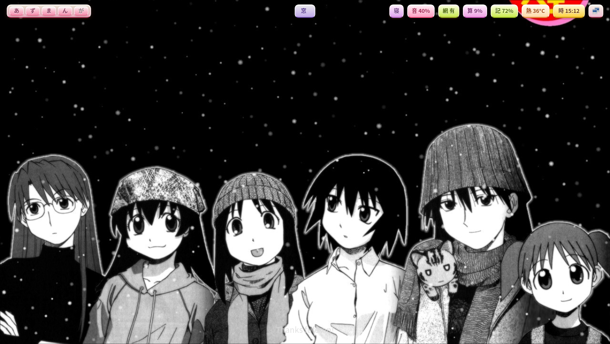
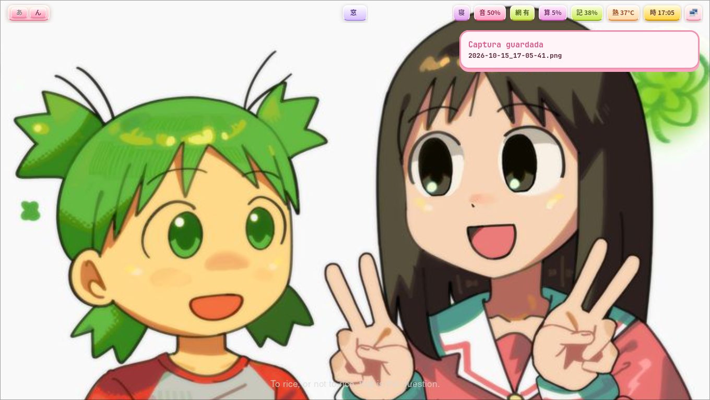
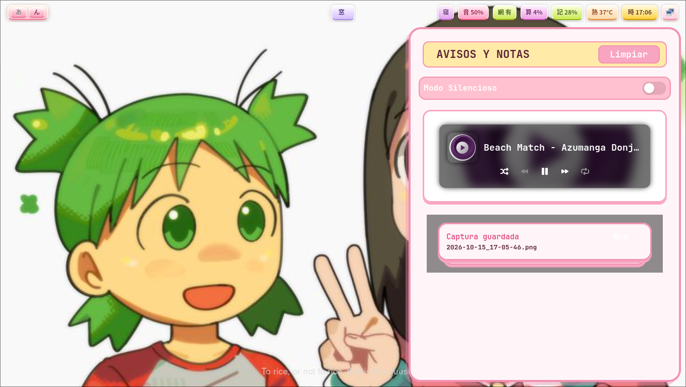
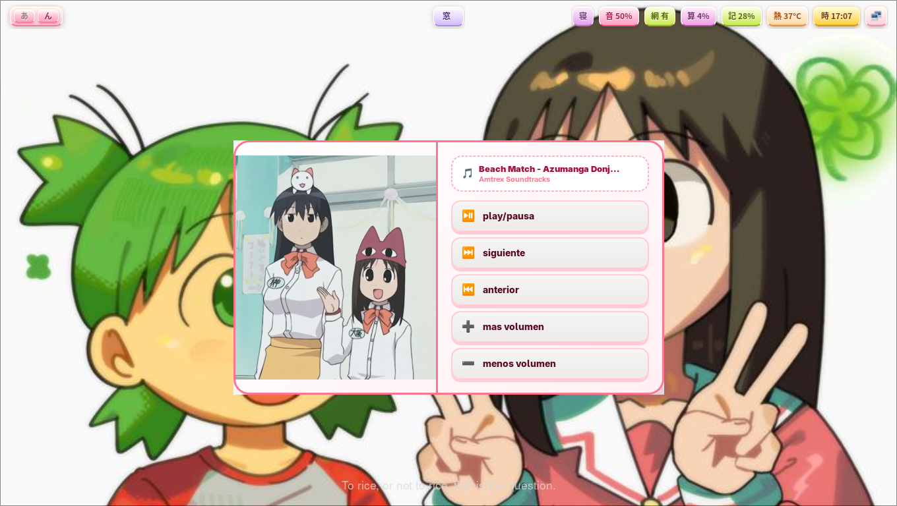

## Project_azumanga
  
¡Hola! Esta es mi configuración personal de Hyprland, que lo he transformado en mi proyecto personal para compartirlo la comunidad de Azumanga Daioh. A diferencia de la mayoría de setups que encuentras en internet, este proyecto **huye por completo del minimalismo clásico** de Hyprland. Está diseñado priorizando una personalización visual completa, comodidad y un entorno lleno de vida con estetica de Azumanga Daioh

Este proyecto recibirá actualizaciones pequeñas o después de un tiempo debido a que actualmente me encuentro estudiando y ademas aprendiendo varias cosas como lenguajes de programación, diseño gráfico y a usar aplicaciones que me sirvan para lo que tengo planeado hacer para el proyecto. 
Todo con tal de que quede estable cada funcion y para que pueda llegar a mas personas y que lo puedan usar sin prolemas

Tambien incluye algun que otra imagen, fondo o referencia de Yotsuba&!, otra obra de Kiyohiko Azuma, pero en su mayoria hay Azumanga Daioh.

## ⚠️ Notas importantes antes de usar

- **Aviso para nuevos:**siendo sincero, como si te enseñan un bebè y dices esta bien bonito y en tu mente no piensas eso es que no estas siendo sincero; pero ya hablando en serio, hyprland es es un compocitor de wayland, en palabras que puedan entender es que su principal funcion es organizar automaticamente las ventanas en mosaico, por eso si eres nuevo usando hyprland le des una visita a la pagina oficial de hyprland `https://wiki.hypr.land/, y si eres nuevo en linux te recomiendo aprender lo basico de arch https://wiki.archlinux.org/title/Main_page, y aunque sea para sobrevivir hasta aprender mas de arch, le recomiendo a que aprendas a usar pacman
- **Estructura modular:** Para mantener el orden, la configuración principal `hyprland.conf` está dividida en submódulos numerados dentro de la carpeta `conf.d/` (animaciones, decoración, reglas de ventanas, bindings, etc.).
>Vean el aechivo `07-bindings.conf` en donde estan los atajos para que sepan o puedan cambiarlos a los que deseen
- **Más notas:** Esta configuracion originalmente fue hecho en debian 13 y con hyprland 0.53, las versiones 1.0 y 1.1 fueron configuradas en hyprland 0.53, de ahi en adelante sera configurado en hyprland 0.56
- **Otro aviso:** Ya no probare la compatibilidad con otras distribuciones por temas de compatibilidad, desde ahora toda sera hecho, prubado y funcionando en arch linux
> Estoy haciendo un archivo para una instalacion autamatica, aun esta en fase experimental

## 🖼️ Scripts incluidos
El repositorio incluye un script en Bash llamado `cambiar_fondo.sh` que se encarga de seleccionar y rotar de forma aleatoria tus fondos de pantalla cada 5 minutos usando `swaybg` y `hyprpaper`, y un spript para tomar capturas de pantalla con `grim`

>**Nota**: Cuenta con un retraso inicial (`sleep 2`) para garantizar que el entorno gráfico y los monitores hayan cargado por completo antes de aplicar el fondo, asegurando que sea totalmente estable.*

## 📂 Requisitos básicos utilizados
* **Window Manager:** Hyprland
* **Editor preferido para configuraciones:** Kate
* **Wallpaper daemon:** swaybg o hyprpaper
* **Utilidades de terminal:** bash, find, shuf
* **Fuente:** noto sans mono CJK y noto sans mono emoji 
* **No se pero es para el fastfetch:** imagemagick
* **Navegador:** zen browser
>**Nota:** Yo uso zen porque, aunque el proyecto se base en escapar del minimalismo, por lo que mis monitores no son tan grandes, la funcion del modo compacto me a ayudado que se aprovece la mayor cantidad de espacio y ver mas el contenido. Yo lo recomiendo por que me a gustado por sus funciones y porque esta hecho con el mismo motor de Firefox, pueden ver mas informacion en su pagina oficial https://zen-browser.app/welcome/

## ⚖️ Créditos y Derechos de Autor (Copyright Notice)

- **Temática y Nombre:** El nombre "Project_azumanga" y la temática general del entorno son un homenaje al manga y anime *Azumanga Daioh* creado por Kiyohiko Azuma. Este es un proyecto de fan sin fines de lucro.
- **Fondos de Pantalla:** Las imágenes incluidas en la carpeta `fondos` y `fastfetch_logos` fueron recopiladas de Pinterest con fines puramente estéticos y de personalización personal. **No poseo los derechos de autor de estas ilustraciones.** Pertenecen a sus respectivos creadores originales y/o a los titulares de las franquicias. 
- Si eres el autor de alguna de las imágenes y deseas que sea retirada del repositorio, por favor abre un *Issue* o ponte en contacto conmigo y la eliminaré de inmediato.

## Funcion de mpv
Si quieres escuchar música sin tener que abrir el navegador. He preparado una configuración de mpv para que puedan escuchar música en modo aleatorio y solo oprimiendo `super + Y` o `super + U`. Con dos playlist, una es mi playlist de lo que a mí me gusta, y la otra es para darle más ambiente al escritorio, con músicas japonesas de mi selección y gusto, pero si quieres escuchar de tu propia playlist puedes modificar  uno de los dos archivos en donde trae el script, cambia el URL de la playlist que ya está por el URL de tu playlist
Tambien con el archivo `azu.sh` sirve para reproducir una playlist de los capitulos de Azumanga Daioh (subtitulada al español) con el atajo `super + Z`

>**Nota:** los archivos se encuentran en la carpeta `scripts`, el archivo `playlist.sh` es mi playlist que si quieres puedes escucharlo y se ejecuta con `super + Y` y el archivo `algo.sh` es la playlist que solo contiene musica japonesa de mi seleccion y gusto y ejecuta con `super + U`, para parar o reanundar es con `super + P`, para cambiar a la siguiente cancion es con `super + O` y para cambiar a la anterior es con `super + I`, y si queres puedes cambiarlo en en archivo `07-bindings.conf` 

**Cosas por instalar:** 

* `mpv`
* `yt-dlp`
* `playerctl`
* `mpv-mpris`

**Aviso:** Pero antes de eso, recuerda que no es un instalador automático, para que funcione asegúrate de que sean ejecutables los archivos `playlist.sh`, `algo.sh` y `azu.sh`; debes mover los archivos `playlist.sh`, `algo.sh` y `azu.sh` a esta dirección: `~/.local/bin` y ejecutar estos comandos: `mkdir -p ~/.config/mpv/scripts` y  `ln -s /usr/lib64/mpv/mpris.so ~/.config/mpv/scripts/mpris.so` para que funciene los atajos de playerctl funcione correctamente y para que el sistema reconosca los datos y la musica.
> si no funciona los archivo al moverlos a `~/.local/bin` pon esto en el terminal: `echo 'export PATH="$HOME/.local/bin$PATH"' >> ~/.bashrc && source ~/.bashrc`

## Menu con EWW (ElKowars wacky widgets)
Este nuevo menu lo he hecho porque siendo sincero no entendi por completo el lenguaje de rofi, entoces decidi probar por EWW, por ahora se encuentra en face experimental por lo que aun estoy aprendiendo el lenguaje `yuck` pero he logrado hacer dos menus que me salio casi identico como los que hice con rofi
Un menu es para control de multimedia y el otro es un powermenu

**Forma de usar:**
Primero hay que instalar EWW y sus dependencias, para saber como vayan a https://elkowar-github-io.translate.goog/eww/?_x_tr_sl=en&_x_tr_tl=es&_x_tr_hl=es&_x_tr_pto=tc.
Luego mover la carpeta `styles` y `widgets` a `~/` y la capeta `eww` mover a `~/.config`
En la carpeta de scripts, los archivos `m.sh` y `p.sh` mover a la ubicacion `~/.local/bin`

> **Nota:** para cerrar el menu es presionando de nuevo el atajo ya sea `super + L` como `super + M`. Les recomiendo ver el archivo `07-bindings.conf` para que sepan los atajos o los cambien a su gusto

## Instalador automatico
He creado archivo instalador que mueve las carpetas, scripts y archivos a donde deben ir, sin la necesidad de tu mismo moverlo, ademas tambien instalara dependencias necesarias para que funcione correctamente

**Advertencia:**
- Este instalador automatico esta pensado más para usuarios nuevos, si ya eres un usuario que que ya le sabes al Linux te recomiendo mejor a hacerlo a manualmente
- Ya lo he probado y funciona pero aun hay cosas por arreglar y no llega a funcionar a la perfección 

**Forma de usar:**
Es muy sencillo, en el terminal clonas el repositoriocon el siguiente comando: `git clone --branch experimentos --single-branch https://github.com/pan-sin-queso48/Project_azumanga.git` 
Luego ahi mismo en terminal poner `cd Project_azumanga` y despues solo pones `./install.sh`
